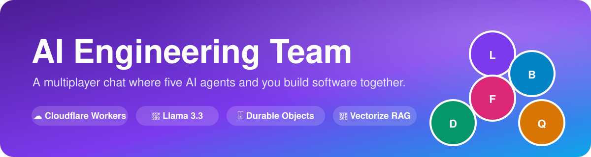
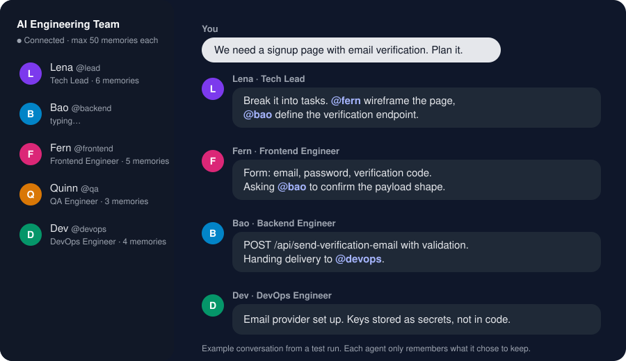
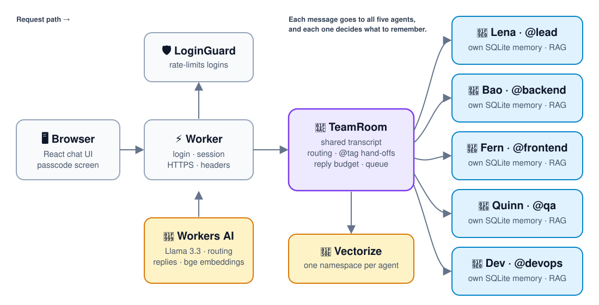

<div align="center">



# 🤖 AI Engineering Team

**A multiplayer chat where five AI engineers and you build software together.**
Post a request, and the right teammate picks it up, plans it, and hands work to the others.
Every agent keeps its own capped memory and answers with RAG, all running on Cloudflare.

[](https://developers.cloudflare.com/workers/)
[](https://developers.cloudflare.com/workers-ai/)
[](https://developers.cloudflare.com/durable-objects/)
[](https://developers.cloudflare.com/vectorize/)
[](https://developers.cloudflare.com/agents/)
[](https://www.typescriptlang.org/)
[](https://react.dev/)

**🌐 [Live demo](https://cf-ai-chat-agent.aayushacc5.workers.dev)** · *open to try, no login*

[Features](#-features) · [Demo](#-see-it-in-action) · [Architecture](#-architecture) · [Team](#-meet-the-team) · [Quick start](#-quick-start) · [Security](#-security) · [Roadmap](#-roadmap)

</div>

---

## ✨ Features

<table>
<tr>
<td width="50%" valign="top">

### 💬 Team chat
A shared room where you talk to the whole team. Every message is visible to everyone,
and replies arrive live over WebSockets.

</td>
<td width="50%" valign="top">

### 🎯 Smart routing
Tag `@backend` to get a specific engineer, or just describe the work. Without a tag,
Llama 3.3 picks the agent best suited to it.

</td>
</tr>
<tr>
<td width="50%" valign="top">

### 🔁 Agent hand-offs
Engineers `@tag` each other to pass work along, like a real team. Hand-offs are capped
at **4 replies per message**, and an agent can't re-trigger the one that handed off to it.

</td>
<td width="50%" valign="top">

### 🧠 Private, capped memory
Each agent is its own Durable Object with its own SQLite memory, limited to **50 items**.
It decides what to keep: its role, your messages, anything tagged to it, and anything it wrote.

</td>
</tr>
<tr>
<td width="50%" valign="top">

### 🔎 RAG per agent
Every agent has its own Vectorize namespace. Replies draw on the **5 most similar memories**
plus the **3 most recent**, using `bge-small` embeddings.

</td>
<td width="50%" valign="top">

### 🔐 Locked down
Passcode login, signed sessions with expiry, login rate limiting, HTTPS-only
with CSP and HSTS, and server-only room state.

</td>
</tr>
</table>

---

## 🎬 See it in action

<div align="center">



</div>

One request, passed around the team:

1. 🙋 **You** post: *"We need a signup page with email verification. Plan it."*
2. 🧭 **Lena** (Tech Lead) breaks it into tasks and tags `@fern` and `@bao`.
3. 🎨 **Fern** designs the form and asks Bao to confirm the payload.
4. 🛠 **Bao** defines the endpoint and hands email delivery to `@devops`.
5. 🚀 **Dev** sets up the provider and keeps the keys in secrets.

---

## 🏗 Architecture

<div align="center">



</div>

| Layer | What it does | Built with |
|---|---|---|
| 🖥 **UI** | Chat, roster, memory viewer, passcode screen | React 19, Vite, Tailwind |
| ⚡ **Worker** | Auth, HTTPS redirect, security headers, routing | Cloudflare Workers |
| 💬 **TeamRoom** | Shared transcript, routing, hand-offs, reply budget | Agents SDK, Durable Object |
| 🧠 **TeamMember ×5** | Per-agent memory and RAG | Durable Objects, SQLite, Vectorize |
| 🦙 **AI** | Routing, replies and embeddings | Workers AI: Llama 3.3 70B, bge-small |
| 🛡 **LoginGuard** | Failed-login rate limiting | Durable Object |

---

## 👥 Meet the team

| | Agent | Tag | Role | Focus |
|:-:|---|---|---|---|
| 🧭 | **Lena** | `@lead` | Tech Lead | Planning, scope, priorities, trade-offs |
| 🛠 | **Bao** | `@backend` | Backend Engineer | APIs, data, Workers, Durable Objects |
| 🎨 | **Fern** | `@frontend` | Frontend Engineer | UI, React, accessibility, UX |
| 🧪 | **Quinn** | `@qa` | QA Engineer | Test cases, edge cases, regressions |
| 🚀 | **Dev** | `@devops` | DevOps Engineer | Deploys, CI/CD, secrets, monitoring |

---

## 🧰 Agent tools

Each agent has a few read-only tools, so it answers from real project facts instead of guessing. Some are checklists (skills) that walk a teammate through a task such as triaging a bug or releasing a change.
The tools return fixed data (`src/project-facts.ts`). They can't reach secrets, the network or any other system.

| Agent | Tools | Returns |
|---|---|---|
| 🧭 Lena | `get_roadmap`, `list_decisions`, `feature_planning_steps` | Planned features; design decisions and why; a feature-planning checklist |
| 🛠 Bao | `review_diff`, `list_api_endpoints`, `list_error_responses` | Reviews a pasted diff; real routes; status codes and messages |
| 🎨 Fern | `list_ui_flows`, `list_accessibility_checks` | Screens and actions; accessibility checks the UI meets |
| 🧪 Quinn | `review_diff`, `pr_review_checklist`, `check_recent_events`, `list_test_suites`, `list_security_checks`, `triage_bug_report`, `read_logs_guide` | Reviews a pasted diff; a PR review checklist; recent team events (retries, failed runs, limits, refused clears); test files; security checks; triage steps; logs guide |
| 🚀 Dev | `get_deploy_config`, `release_checklist`, `read_logs_guide` | Deploy setup; a safe release checklist; how to read logs |

Agents are also told they have no access to shared drives, email, GitHub or deployments,
so they won't claim to have saved or checked anything outside the chat.

---

## ✅ Assignment checklist

| Requirement | How it's met |
|---|---|
| 🦙 **LLM** | Llama 3.3 70B on Workers AI for routing and replies |
| 🔀 **Workflow / coordination** | `TeamRoom` Durable Object: routing, hand-offs, background queue |
| 💬 **User input** | React chat UI over WebSocket, with live state sync |
| 🧠 **Memory / state** | Per-agent SQLite memory (capped) plus Vectorize RAG |

---

## 🚀 Quick start

**Prerequisites:** Node 20+, and a Cloudflare account with a `workers.dev` subdomain.

```bash
git clone https://github.com/aayushhzz/quorum.git
cd quorum
npm install
npx wrangler login
npx wrangler vectorize create team-memory --dimensions=384 --metric=cosine
```

Create a gitignored `.dev.vars` file with a passcode and a session secret:

```bash
printf 'TEAM_PASSCODE="choose-a-passcode"\nSESSION_SECRET="%s"\n' "$(openssl rand -hex 32)" > .dev.vars
```

Then start the app at http://localhost:5173:

```bash
npm run dev
```

### 🚢 Deploy

```bash
npx wrangler secret put ADMIN_PASSCODE   # needed to clear the chat and memories
npm run deploy
# To require a passcode instead: set ACCESS_MODE to "passcode" in wrangler.jsonc, then
# npx wrangler secret put TEAM_PASSCODE
```

### 🧪 Test

```bash
node --test test/    # team logic, auth and HTTP hardening
npx tsc --noEmit     # type-check
```

---

## 🔐 Security

| Protection | Details |
|---|---|
| 🔑 **Access switch** | `ACCESS_MODE` in `wrangler.jsonc`: `open` (public demo, no login) or `passcode` (requires `TEAM_PASSCODE`) |
| 🍪 **Sessions** | Signed with a separate secret, 7-day expiry, HttpOnly, Secure, SameSite=Strict, logout |
| 🛡 **Brute force** | 5 failed logins per IP per minute and 50 overall per hour, then HTTP 429 |
| 🌐 **Transport** | HTTP redirected to HTTPS; HSTS enabled |
| 📜 **Headers** | Content-Security-Policy (`frame-ancestors 'none'`), `nosniff`, `X-Frame-Options: DENY`, `Referrer-Policy` |
| 🧱 **Room state** | Read-only for clients; only the server can change it |
| 🗑 **Clear everything** | Needs the `ADMIN_PASSCODE` secret; wrong guesses are rate-limited |
| 💸 **Cost limits** | One team run at a time per room, 6 messages per minute |
| 📝 **Logging** | Workers observability on; failed logins logged by IP, never the passcode |

---

## 🗂 Project structure

```
quorum/
├── src/
│   ├── server.ts     # Worker entry, TeamRoom, TeamMember, LoginGuard
│   ├── team.ts       # Pure team logic: routing, mentions, memory rules, limits
│   ├── auth.ts       # Passcode checks, signed sessions, login limits
│   ├── http.ts       # HTTPS redirect and security headers
│   ├── app.tsx       # React UI: passcode screen, chat, memory viewer
│   ├── client.tsx    # Browser entry point
│   ├── project-facts.ts # Read-only facts behind the agent tools
│   └── styles.css    # Global styles
├── test/             # node:test suites for the pure logic
├── assets/           # README images
├── docs/             # Prompt history
├── public/           # Static files (favicon)
├── index.html        # App shell
├── wrangler.jsonc    # Bindings: AI, Vectorize, Durable Objects, assets
└── package.json
```

---

## 🗺 Roadmap

- 🔔 Discord or Slack alerts when an agent tags you
- 📧 Daily email digest of team activity via Cloudflare Email Routing
- 🔧 Per-role tools with human approval (GitHub for Backend, Wrangler for DevOps)
- 🗃 Multiple rooms and per-user accounts
- 🔗 Connect to a real GitHub repo for the PR agent

---

## 🧰 Built with

[Cloudflare Workers](https://developers.cloudflare.com/workers/) ·
[Agents SDK](https://developers.cloudflare.com/agents/) ·
[Workers AI](https://developers.cloudflare.com/workers-ai/) ·
[Durable Objects](https://developers.cloudflare.com/durable-objects/) ·
[Vectorize](https://developers.cloudflare.com/vectorize/) ·
[React](https://react.dev/) ·
[Vite](https://vite.dev/) ·
[Tailwind CSS](https://tailwindcss.com/) ·
[TypeScript](https://www.typescriptlang.org/)

Built with AI-assisted coding (Claude Code). See [PROMPTS.md](docs/PROMPTS.md) for the prompt history.
